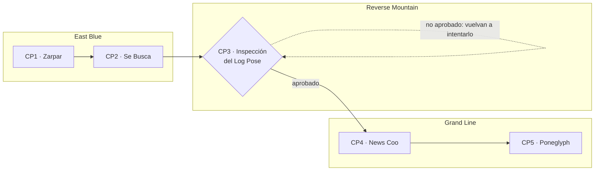
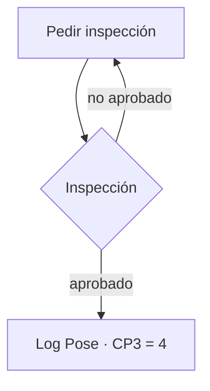

# Hackathon Frontend: One Piece — Rumbo al Grand Line

## Ejecutar la implementación de CP1 y CP2

Requisitos: **Node 24 LTS** y npm. Se incluye `package-lock.json` para instalaciones reproducibles.

```sh
npm ci
cp .env.example .env
npm run dev
```

En PowerShell, usa `Copy-Item .env.example .env` en lugar de `cp`. Abre la URL que muestra Vite
(normalmente `http://localhost:5173`). `.env` debe definir `VITE_API_BASE_URL`; no se incluye una URL
de respaldo en el código de la aplicación. Reinicia Vite después de modificar esta variable.
La API pública del curso está indicada en `.env.example` y en el enunciado conservado abajo.

Registra tu tripulación en `/register` o entra en `/login` con su cuenta existente. El registro inicia
sesión automáticamente y muestra el código asignado por el servidor. `/` muestra el dashboard real;
`/wanted` contiene filtros, búsqueda, orden y paginación de servidor. Cada cartel abre su expediente.
La aplicación requiere conexión con la API y **no tiene un modo de datos ficticios**.

```sh
npm run lint
npm run typecheck
npm test
npx playwright install chromium
npm run test:e2e -- --workers=2
npm run build
npm run preview
```

Las pruebas unitarias y de navegador usan fixtures aisladas en `tests/`, sin consumir cuentas reales.
Playwright inicia Vite automáticamente en el puerto 5173 y ejecuta Chromium en escritorio y con
viewport/touch móvil; no equivale a probar Safari en un iPhone real. Para desplegar `dist/`, configura
el hosting con fallback a `index.html` para las rutas de React Router.

Organización: `src/auth` administra sesión y restauración; `src/lib` contiene el cliente Fetch, tipos,
consultas URL y carga cancelable; `src/components` reúne componentes compartidos; `src/pages` contiene
las pantallas. El token se conserva en `localStorage` para restaurar la sesión con `/auth/me`, se borra
al salir o recibir un 401 privado, y se sincroniza entre pestañas. Las contraseñas nunca se almacenan.
El estado del listado reside en la URL; el desplazamiento se recuerda en `sessionStorage`.

Consulta [CP1_CP2_STATUS.md](./CP1_CP2_STATUS.md) para la matriz de criterios y evidencia de pruebas.
El contrato público recuperado está en [docs/openapi.json](./docs/openapi.json).
CP3 (inspección presencial), CP4 y CP5 siguen fuera de esta implementación.

**Integrantes y entrega académica:** este repositorio no incluía nombres, códigos de estudiantes ni
el `TEAM_CODE` oficial. Deben incorporarse los datos reales de la tripulación al README y a
`hackathon.json` antes de la entrega; no se inventaron identidades ni se usó la cuenta de validación
como cuenta oficial. El enunciado original completo se conserva a continuación.

---

> *"¡El One Piece existe!"* — Edward Newgate

## Descripción General

La Gran Era de los Piratas está en su punto más alto. La **Guild de Cazarrecompensas** necesita el
**Log Pose Console**, una consola en React + TypeScript para seguir los carteles de "Se Busca", leer
las noticias del mundo y recorrer la gran saga del Grand Line.

Cada equipo es una tripulación de cazarrecompensas. El viaje tiene tres tramos:



Nadie entra al Grand Line sin un **Log Pose**. En Reverse Mountain, un inspector (TA o profesor)
revisa a cada tripulación: si demuestra que sabe navegar, recibe el Log Pose y se desbloquea la API
del Grand Line. Si no aprueba, puede volver a pedir la inspección; sin Log Pose no hay Grand Line.

La Guild tiene dos reglas:

1. **Regla de Nami:** nada se cuenta dos veces.
2. **Regla del Log Pose:** la consola nunca muestra un rumbo falso. Lo que se ve siempre corresponde a
   lo último que pidió el usuario.

El backend ya existe y será entregado como una API cerrada. Cada equipo trabajará en un workspace
aislado. No recibirán código del backend, acceso a base de datos, logs ni paneles administrativos.

El uso de IA para programar está permitido, pero la aplicación no debe consumir APIs de IA. Toda la
data, narrativa y contenido visual llegan desde el backend. **En Reverse Mountain no hay IA:** tendrán
que explicar ustedes mismos lo que construyeron.

---

## Duración y Formato

- **Tiempo:** 2 horas exactas.
- **Equipos:** 3 estudiantes.
- **Recursos:** IA, documentación e Internet permitidos para construir. En la inspección no se
  permite IA ni celular.
- **Backend:** API compartida del curso, aislada por equipo.
- **Repositorio:** el que reciben por GitHub Classroom.
- **Evaluación:** el CP1, CP2, CP4 y CP5 se evalúan por comportamiento sobre el código entregado. El
  CP3 es una inspección presencial.
- **Entrega:** último commit en `main` a las 2:00.

| Hora | Qué pasa |
|:-----|:---------|
| 0:00 | Inicio. Registren su tripulación en la API. |
| ~0:20 a ~1:40 | Solicitudes de inspección del CP3 abiertas (el equipo docente las abre y las cierra). |
| 2:00 | Cierre. Se evalúa el último commit en `main`. |

---

## Stack Obligatorio

- React 18+.
- TypeScript estricto.
- Componentes en `.tsx`.
- Vite.
- React Router.
- Tailwind CSS.
- Fetch API o Axios.

El proyecto se crea con Vite (plantilla `react-ts`) en la raíz del repositorio que reciben, sin borrar
sus archivos. Usen npm, suban `package-lock.json` y trabajen con Node 24 LTS.

### No Permitido

- Material UI, Ant Design, Chakra, Mantine, NextUI/HeroUI, DaisyUI o dashboards completos.
- React Query, SWR, TanStack Query, RTK Query o equivalentes.
- Librerías que resuelvan caché de servidor, estado en URL o infinite scroll.
- Librerías de animación o scrollytelling: GSAP, Motion (Framer Motion), Scrollama, AOS, Lenis o
  equivalentes.
- Cargar el dataset completo para simular paginación.
- Copiar un template de dashboard.
- Imágenes o logos oficiales del anime o del manga.

---

## Acceso a la API

| Recurso | URL |
|:--------|:----|
| API (`VITE_API_BASE_URL`) | https://logpose-api-jg7f.onrender.com/api/v1 |
| Documentación (Swagger UI) | https://logpose-api-jg7f.onrender.com/docs |
| Cola de inspección (CP3) | https://logpose-api-jg7f.onrender.com/reverse-mountain |

```txt
VITE_API_BASE_URL=https://logpose-api-jg7f.onrender.com/api/v1
```

**Una cuenta por equipo.** Un integrante registra la tripulación (nombre del equipo, email y contraseña)
con `POST /auth/register`, desde su app o desde Swagger. El backend le asigna su código de equipo
(`TEAM_CODE`, por ejemplo `TEAM-007`) y le crea un workspace propio: los datos y cambios de otros equipos no
serán visibles. Los tres integrantes inician sesión con ese mismo email y contraseña.

Pueden registrar la tripulación desde Swagger al inicio para empezar a trabajar, y luego probar su propia
pantalla de registro (CP1) con otro nombre y otro email: cada registro crea una tripulación nueva, con su
propio `TEAM_CODE`. La cuenta "oficial" del equipo es la que usen para pedir la inspección del CP3.

La app debe leer la URL base desde la variable `VITE_API_BASE_URL`; no la escriban en el código.

Swagger UI es el contrato público completo de la API y se puede abrir sin iniciar sesión. Allí se
documentan campos, parámetros, enums, respuestas y errores de todos los endpoints.

Todas las rutas, salvo `POST /auth/register` y `POST /auth/login`, requieren:

```txt
Authorization: Bearer <jwt_token>
```

---

## API Pública

| Método | Endpoint | Uso | Tramo |
|:-------|:---------|:----|:------|
| POST | `/auth/register` | Registro de la tripulación con `teamName`, `email`, `password` | East Blue |
| POST | `/auth/login` | Login con `email`, `password` | East Blue |
| GET | `/auth/me` | Restaurar sesión | East Blue |
| GET | `/dashboard/summary` | Indicadores de la tripulación | East Blue |
| GET | `/log-pose` | Estado del Log Pose | East Blue |
| GET | `/crews` | Tripulaciones piratas | East Blue |
| GET | `/wanted` | Carteles de "Se Busca", paginados | East Blue |
| GET | `/wanted/{id}` | Detalle de un cartel | East Blue |
| GET | `/news/feed` | Noticias del mundo, cursor-based | Grand Line 🔒 |
| GET | `/news/{id}` | Detalle de una noticia | Grand Line 🔒 |
| PATCH | `/news/{id}/status` | Verificar una noticia | Grand Line 🔒 |
| GET | `/sagas` | Sagas disponibles | Grand Line 🔒 |
| GET | `/sagas/{id}/story` | Historia visual de una saga | Grand Line 🔒 |

🔒 Hasta aprobar el CP3, los endpoints del Grand Line responden `423 LOG_POSE_REQUIRED`.

### Carteles de "Se Busca"

`GET /wanted`

| Parámetro | Regla |
|:----------|:------|
| `page` | Inicia en 0 |
| `size` | 10, 20 o 50 |
| `status` | Filtro opcional |
| `crewId` | Filtro opcional |
| `fruit` | Filtro opcional (tipo de fruta del diablo) |
| `q` | Búsqueda opcional por nombre o epíteto |
| `sort` | `bounty,desc`, `name,asc` o `updatedAt,desc` |

La respuesta contiene `content`, `totalElements`, `totalPages`, `page` y `size`.

### Noticias del Mundo

`GET /news/feed`

| Parámetro | Regla |
|:----------|:------|
| `cursor` | Cursor opaco recibido anteriormente |
| `limit` | Default 20, máximo 30 |
| `type` | Filtro opcional |
| `priority` | Filtro opcional |
| `status` | Filtro opcional |

La respuesta contiene `items`, `nextCursor` y `hasMore`.

### Verificar una Noticia

`PATCH /news/{id}/status` recibe:

```json
{
  "status": "CONFIRMED"
}
```

Solo una noticia en estado `RUMOR` se puede verificar, como `CONFIRMED` o `DEBUNKED`. La respuesta
exitosa contiene la noticia actualizada.

No se evalúan actualizaciones optimistas, conflictos de versión ni actualizaciones en tiempo real.

### Historia de una Saga

`GET /sagas/{id}/story` devuelve la saga y sus etapas. Cada etapa trae su narrativa, la isla donde
ocurre (con su posición en el mapa), su paleta de colores y sus métricas.

---

## Checkpoint 1 — Zarpar

**Dificultad:** fácil. **Puntaje:** 3.

Construir:

- Registro de la tripulación: crea la cuenta del equipo y entra directo a la app con la sesión iniciada.
  Muestra los errores del servidor (email o nombre ya registrados, datos inválidos) junto al campo que
  corresponde.
- Login con el email y la contraseña de la tripulación.
- Rutas privadas. Si alguien abre una ruta privada sin sesión, después de iniciar sesión vuelve
  exactamente a donde quería ir.
- Restauración de sesión al recargar, sin mostrar el login mientras se verifica.
- Si la sesión deja de ser válida, la app vuelve al login.
- Logout.
- Dashboard con datos reales de `/dashboard/summary` y el estado del Log Pose.
- Loading, error con reintento y estado vacío.
- Página 404.

---

## Checkpoint 2 — Carteles de "Se Busca"

**Dificultad:** media. **Puntaje:** 4.

Construir `/wanted` con:

- Paginación real del servidor.
- Filtros combinables: estado, tripulación y tipo de fruta del diablo.
- Búsqueda por nombre o epíteto, sin una request por cada tecla.
- Ordenamiento y tamaño de página.
- Estado completo reflejado en la URL: recargar, compartir la URL o usar atrás y adelante muestra
  exactamente lo mismo.
- Una URL con valores inválidos no rompe la vista.
- Cambiar filtros, búsqueda u orden nunca deja al usuario en una página que ya no existe.
- Protección contra respuestas antiguas que llegan tarde.
- Loading, error con reintento y sin resultados, sin mover el layout.
- Detalle del cartel en `/wanted/:id`. Al volver, el listado está exactamente como se dejó.

---

## Checkpoint 3 — Reverse Mountain: Inspección del Log Pose

**Tipo:** validación presencial. **Puntaje:** 4.

Un inspector se acerca a la tripulación y comprueba dos cosas: que el CP1 y el CP2 **funcionan** y
que la tripulación **entiende por qué funcionan**. Si aprueban, reciben el Log Pose y se desbloquea la
API del Grand Line. **Sin Log Pose no pueden seguir.**

### Cómo se pide

1. Con el CP1 y el CP2 funcionando en su app local, entren a la cola de inspección con la cuenta de la
   tripulación y pidan la inspección.
2. Se atiende en orden de solicitud, mientras el equipo docente tenga abiertas las solicitudes
   (aproximadamente entre las 0:20 y la 1:40).

### Cómo es

1. **Demostración (~1.5 min):** el inspector pide ver situaciones concretas del CP1 y el CP2 en su
   app.
2. **Preguntas (~2 min):** dos preguntas sobre cómo y por qué funciona lo que construyeron. **El
   inspector elige qué integrante responde cada una.** Responde solo esa persona: sin ayuda de sus
   compañeros, sin IA y sin celular.
3. **Veredicto:** aprobado o no aprobado.

Para aprobar, lo que se muestra debe funcionar y cada respuesta debe explicar qué problema se resuelve
y cómo lo resolvieron en su app.



- No hay límite de intentos: si no aprueban, pueden volver a pedir la inspección de inmediato mientras
  las solicitudes estén abiertas. Las preguntas son otras y el inspector vuelve a elegir quién responde.
- Si la demostración falla, la inspección termina ahí como no aprobada.
- Si al cierre no tienen el Log Pose, el CP3, el CP4 y el CP5 valen 0.
- Mientras esperan la inspección pueden avanzar el CP4 y el CP5 con la documentación de Swagger, que
  incluye respuestas de ejemplo de esos endpoints.

---

## Checkpoint 4 — News Coo: Noticias del Mundo

**Dificultad:** media-alta. **Puntaje:** 4. **Requiere:** Log Pose.

Construir el feed `/news` con:

- Infinite scroll basado en cursor.
- Carga automática al llegar al final.
- Ninguna noticia aparece dos veces.
- Una sola carga adicional en vuelo.
- Filtros (tipo, prioridad y estado) persistidos en la URL.
- Cambiar filtros mientras hay una carga en vuelo nunca mezcla resultados.
- Fin de lista correcto.
- Recuperación de error sin borrar las noticias ya cargadas.
- Detalle de la noticia en `/news/:id`. Al cerrarlo, el feed conserva su posición sin volver a pedir
  lo que ya tenía.

En el detalle, permitir verificar un rumor:

- Marcarlo como `CONFIRMED` o `DEBUNKED`.
- Deshabilitar la acción mientras la request está en vuelo.
- Mostrar confirmación al completar.
- Si falla, mostrar un error accionable, conservar el estado anterior y permitir reintentar.
- Reflejar el nuevo estado en el feed al volver.

---

## Checkpoint 5 — Poneglyph: la Gran Saga

**Dificultad:** difícil. Este es el reto principal de la hackathon. **Puntaje:** 5. **Requiere:** Log
Pose.

Los Poneglyphs guardan la verdadera historia del mundo. Construir:

- `/sagas`: resumen de las sagas disponibles.
- `/sagas/:id`: la saga contada como una experiencia de scrollytelling, basada exclusivamente en la
  data de `/sagas/{id}/story`.

La historia debe incluir:

- Narrativa por etapas activadas por scroll.
- Un mapa persistente del Grand Line: el barco se ubica en la isla de la etapa activa y la ruta
  recorrida se dibuja a medida que se avanza.
- Colores y métricas que cambian con la etapa activa. Las métricas visibles siempre corresponden a esa
  etapa.
- Progreso del recorrido.
- CSS Scroll-driven Animations cuando exista soporte y un comportamiento equivalente cuando no exista.
- View Transition API entre el resumen y la historia cuando exista soporte y navegación normal cuando
  no exista.
- La URL indica la etapa activa: abrir esa URL lleva directo a esa etapa.
- Comportamiento equivalente en desktop y mobile.
- Soporte para `prefers-reduced-motion`: la historia completa se entiende sin animaciones.
- Navegación por teclado entre etapas sin perder contenido.

No se acepta video, GIF, canvas pregrabado ni una lista de cards con animación decorativa.

---

## Evaluación

| Checkpoint | Tramo | Dificultad | Evaluación | Puntos |
|:-----------|:------|:----------:|:-----------|:------:|
| CP1 — Zarpar | East Blue | Fácil | Comportamiento | 3 |
| CP2 — Carteles de "Se Busca" | East Blue | Media | Comportamiento | 4 |
| CP3 — Inspección del Log Pose | Reverse Mountain | Validación | Inspección presencial | 4 |
| CP4 — News Coo | Grand Line | Media-alta | Comportamiento | 4 |
| CP5 — Poneglyph | Grand Line | Difícil | Comportamiento | 5 |
| **Total** | | | | **20** |

- **CP1, CP2, CP4 y CP5:** el puntaje es proporcional a los requisitos que se cumplen. Si la
  funcionalidad principal del checkpoint no funciona, vale 0.
- **CP3:** 4 si aprueban la inspección, 0 si no la aprueban. Sin Log Pose, el CP4 y el CP5 también valen 0.

Además:

- si `npm run build` falla, la nota es 0;
- TypeScript estricto, sin errores de tipos;
- no se acepta `any` (descuento de 2 puntos);
- no se exigen tests automatizados de frontend.

---

## Reglas de Evaluación

- Los checkpoints se validan por comportamiento, no por cantidad de archivos.
- La evaluación usa datos distintos a los de su workspace. Datos hardcodeados invalidan la entrega.
- Paginación simulada en cliente invalida la entrega.
- Un botón "Cargar más" no cuenta como infinite scroll.
- Una actualización que no maneja loading o error no cuenta.
- Una animación que ignora reduced motion no cuenta.
- En la inspección responde solo el integrante elegido por el inspector.
- Intentar evadir el bloqueo del Log Pose invalida la entrega.
- Se compara la similitud de código entre equipos.

---

## Entregables

En `main`, a las 2:00:

1. El código del proyecto.
2. `hackathon.json` completo, con el código del equipo (el `TEAM_CODE` de la cuenta con la que pidieron
   la inspección del CP3) y los integrantes.
3. `README.md` con los integrantes (nombre y código) y cómo ejecutar el proyecto.

No entregar backend, dumps, seeds ni credenciales (no suban la contraseña de la tripulación al repositorio).

---

## Referencias Permitidas

- React: https://react.dev/
- React Router: https://reactrouter.com/
- View Transition API: https://developer.mozilla.org/en-US/docs/Web/API/View_Transition_API
- Scroll-driven animations: https://developer.mozilla.org/en-US/docs/Web/CSS/Guides/Scroll-driven_animations
